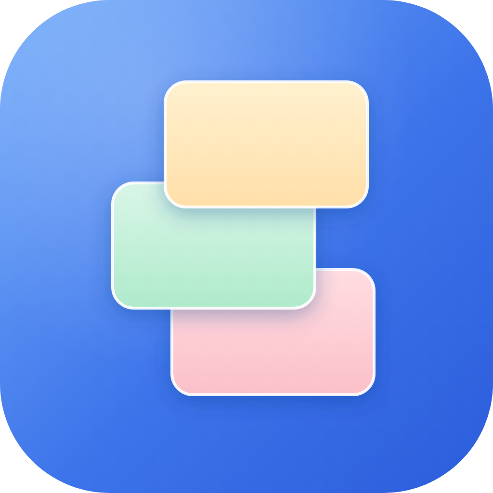

<div align="center">



# LongStitch · 长截图拼合工具

**把多张滚动截图拼成一张完整长图——每一条拼缝都看得见、可质疑、能手动修正。**

[](LICENSE)
[](https://dotnet.microsoft.com/download/dotnet/8.0)


</div>

---

## 简介

手机上的长截图（尤其 iOS）在页面很长时会被系统缩小或压缩，导出的往往不是一张像素完整的图。
LongStitch 把 2 张以上的连续滚动截图拼回一张完整长图，并坚持三条底线：

- **导出按源图像素计算**，绝不为适应预览窗口而降分辨率——屏幕上缩到 10% 和导出 1170×52000 是两件事；
- **每条拼缝独立审核**：自动匹配给出 `✓ 自动匹配` / `! 需检查` / `手动待确认` 三种状态并带可读原因，可逐条复核、手动挪动、确认或恢复自动；
- **完全离线运行**，无任何网络访问、无任何第三方依赖。

## 功能特性

- 🧩 **三种拼合模式**（见下表），自动找重叠区、对齐、去重
- ✂️ **两侧真裁切**：长截图重叠区两侧各裁一刀，真删掉重复那份，不是简单叠加
- 🔍 **逐条拼缝审核**：缝线颜色随匹配状态变化，蓝线可拖、方向键逐像素微调
- ↩️ **撤销 / 重做**（Ctrl+Z / Ctrl+Y），一次拖动算一条记录
- 💾 **项目文件**（`.lstickx`，含原图打包）保存与打开
- 🖼 **分块导出**：由参数在离屏重建、分块编码，几万像素高也不会内存爆掉
- 🌗 **深色 / 浅色 / 跟随系统**三档主题
- 🧾 **诊断日志与 F8 读数层**：定位问题可自助导出诊断信息

| 模式 | 输入 | 行为 |
| --- | --- | --- |
| 长截图 | 同一页面连续滚动的 2 张以上截图 | 自动对齐并裁掉重叠，每条拼缝可独立审核 |
| 竖拼 | 独立图片，从上到下 | 首尾排列，不去重，可手动调接缝 |
| 横拼 | 独立图片，从左到右 | 首尾排列，不去重，可手动调接缝 |

## 快速开始

### 方式一：下载免安装版

到 [Releases](https://github.com/liulifeili/LongStitch/releases) 页面下载 `LongStitch.exe`（自包含单文件，约 100–155 MB），双击即可运行，**不需要安装 .NET**。

### 方式二：从源码构建

需要 [.NET 8 SDK](https://dotnet.microsoft.com/download/dotnet/8.0)，不需要其它任何东西：

```powershell
dotnet build                                   # 编译
dotnet run --project src/LongStitch.App        # 打开主程序
```

发布成免安装单文件：

```powershell
dotnet publish src/LongStitch.App -c Release -r win-x64 --self-contained `
  -p:PublishSingleFile=true -p:IncludeNativeLibrariesForSelfExtract=true `
  -o publish
```

## 基本操作

| 操作 | 效果 |
| --- | --- |
| 左键拖动（空白处） | 平移画布 |
| 滚轮 / `Ctrl`+滚轮 | 上下滚动 / 以指针为中心缩放 |
| 点蓝线或重叠带 | 进入该拼缝编辑 |
| 拖动（编辑中，长截图） | 滑动该张图，选择重叠内容要哪一份 |
| `↑` `↓` | 编辑中逐像素微调；其它时候平移视口 |
| `Esc` | 退出编辑 |
| `F3` | 跳到下一条需检查的拼缝 |
| `Ctrl+Z` / `Ctrl+Y` | 撤销 / 重做 |

完整交互契约（按下优先级、微调档、固定侧语义等）见 [docs/开发手记.md](docs/开发手记.md) 的「操作速查」一节。

## 测试与验证

项目自带一套 343 格的"精度电池"（含防假绿的变异守卫），外加独立 Python 验证器交叉核对：

```powershell
dotnet run --project checks/LongStitch.Checks              # 全部判据
dotnet run --project checks/LongStitch.Checks -- --only png # 只跑一组
python checks/doc_cell_check.py                            # 文档判据引用门禁
python checks/round14_audit.py                             # 需求↔证据对账门禁
```

退出码 `0` = 全绿。PNG 导出承诺几何与像素无损（有字节级自证测试）；JPEG 为有损格式，界面会明确标注。
更多口径与逐轮验证记录见 [docs/开发手记.md](docs/开发手记.md)。

## 项目结构

```
longstitch/
├── src/
│   ├── LongStitch.Core/      不依赖 UI、零 NuGet 依赖的核心库
│   │   ├── Geometry/         整数几何（IntPoint / IntRect …）
│   │   ├── Imaging/          自研 PNG/TIFF 编解码、像素缓冲
│   │   ├── Model/            项目文档、源图、拼缝、设置
│   │   ├── Layout/           参数 → 画布整数落位
│   │   ├── Matching/         重叠匹配
│   │   ├── Export/           分块导出引擎
│   │   └── Preview/          瓦片预览与 LRU 缓存
│   └── LongStitch.App/       WinForms 界面壳
├── checks/LongStitch.Checks/ 精度电池（343 格），零依赖控制台工装
├── assets/                   应用图标（SVG / PNG / ICO 三件套）
└── docs/                     架构说明、精度红线、匹配算法、构建发布、开发手记
```

## 文档

- [docs/架构说明.md](docs/架构说明.md) — 代码结构与设计决策
- [docs/精度红线.md](docs/精度红线.md) — "一像素不出错"到底承诺什么
- [docs/匹配算法.md](docs/匹配算法.md) — 重叠匹配的原理与判据
- [docs/构建与发布.md](docs/构建与发布.md) — 构建与发布细节
- [docs/开发手记.md](docs/开发手记.md) — 逐轮开发与验证的完整手记（篇幅较长，进阶阅读）

## 版权与许可

Copyright © 2026 liulifeili

本项目基于 [MIT License](LICENSE) 开源发布——可自由使用、修改、分发与商用，唯一要求是保留版权与许可声明。
软件按"现状"提供，不含任何形式的担保。
